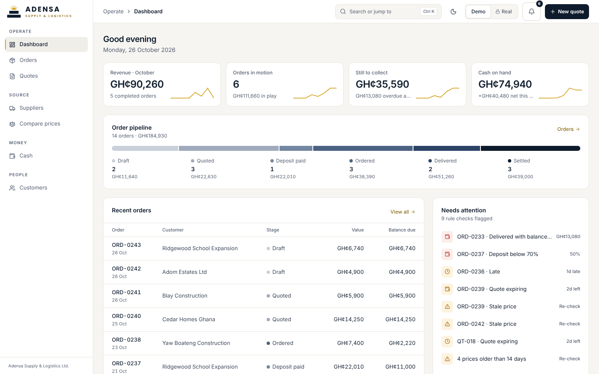
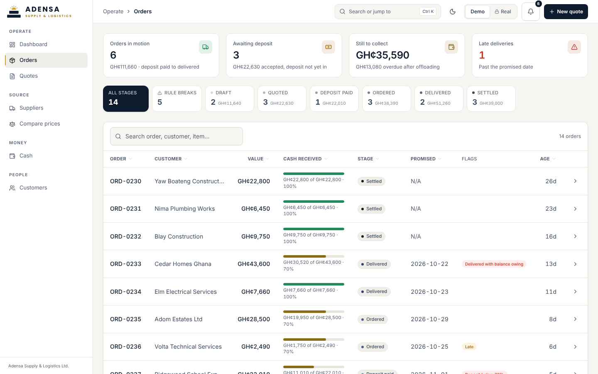
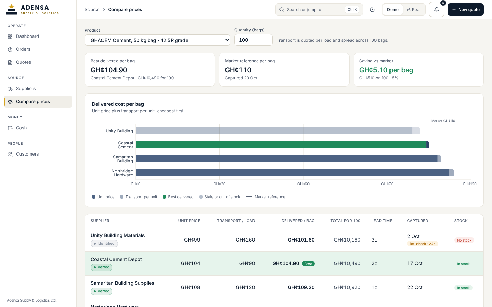
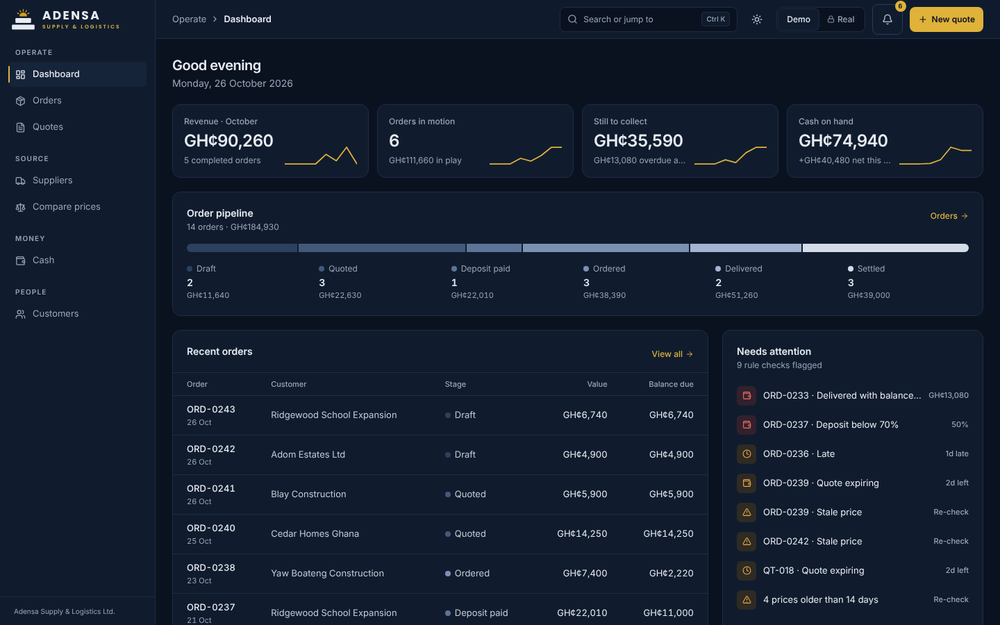
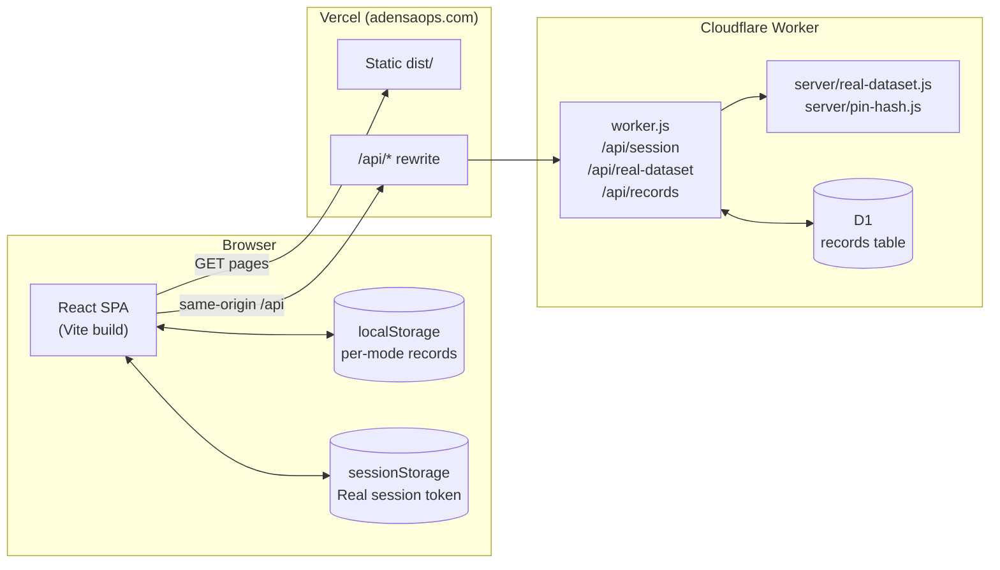

<p align="center">
  
</p>

<h1 align="center">AdensaOps</h1>

<p align="center">
  Operations and procurement platform for <b>Adensa Supply &amp; Logistics Ltd</b>, a building-materials supplier in Accra, Ghana.<br/>
  <i>Your project. Our procurement.</i>
</p>

<p align="center">
  <a href="https://adensaops.com">Live demo</a> ·
  <a href="#case-study">Case study</a> ·
  <a href="#architecture">Architecture</a> ·
  <a href="#getting-started">Run it locally</a>
</p>



AdensaOps runs the company's order pipeline end to end: customer quotes built
from real supplier prices, orders gated by the deposit rules, delivery and
receipt capture, cash in and out, and a dashboard that checks every order
against the business rules. It is a React + TypeScript single-page app with a
Cloudflare Worker + D1 backend.

The public deployment opens in **Demo** mode: synthetic data, dated relative to
today and kept moving by a live simulation. **Real** mode holds the company's
own records behind a PIN that is verified on the server.

---

## Case study

**The problem.** Building-materials supply in Accra runs on many small
suppliers, fast-moving prices and cash-heavy terms. AdensaOps is built around
three risks in that work: supplier prices going stale between quotes,
transport left out of a quote so the margin looks better than it is, and goods
offloaded before the customer has paid.

**What the product does about it.**

| Business rule | How the app enforces it |
|---|---|
| A 70% deposit confirms an order | Quotes print the deposit; orders below it are flagged "Deposit below 70%" |
| Established clients (3+ fully paid orders) may pay 50% | `requiredDepositRate` checks the customer's history automatically |
| The balance is due before offloading | Delivered orders that still owe money are flagged and listed first in collections |
| Supplier prices older than 14 days must be re-checked | Stale prices are never chosen as "best" and never auto-fill a quote |
| Payments only into the company MoMo merchant or bank account | Printed on every quote and unpaid invoice |

**Decisions worth calling out.**

- **One source of truth for numbers.** Dashboard, Orders and Cash used to
  compute "still to collect" three different ways. `src/lib/metrics.ts` now
  defines every shared figure once, and a render test asserts the three pages
  agree.
- **Business rules as code.** `src/lib/rules.ts` produces the rule-break
  flags; the UI only displays them. The demo seed is tested to contain exactly
  one example of each break.
- **Delivered cost, not sticker price.** Transport is quoted per load, so
  `src/lib/compare.ts` spreads it across the quantity. The cheapest supplier
  can change with quantity; the quote builder reuses the same function, so a
  quote can never disagree with the comparison screen.
- **Private data stays on the server.** The real dataset and the PIN hash used
  to ship in the JavaScript bundle behind a client-side check. They now live in
  `server/`, the PIN is verified by the worker, and a build step fails if any
  real record ever appears in `dist/`.
- **Demo that never goes stale.** Every demo date is an offset from today, so
  the public demo always looks like this week's operations.

<p>
  
  
</p>

## Features

- **Dashboard:** greeting, four KPIs with 8-week sparklines, the pipeline as one
  segmented bar, recent orders, a "Needs attention" rule-check panel and cash
  in/out for the last six weeks.
- **Orders:** stage pipeline (draft, quoted, deposit, ordered, delivered,
  settled) with rule-break flags, a "Rule breaks" filter, deposit, balance and
  delivery-receipt capture, and invoice PDFs.
- **Quotes:** catalogue products with the best delivered supplier cost filled
  in, a transport line per load, markup ladder, real margins, 70% deposit and
  balance, and a printable quote sheet.
- **Suppliers:** network by category and status, supplier map (Leaflet),
  price freshness.
- **Compare prices:** delivered cost per unit at a chosen quantity, savings
  against the market reference, capture activity on a real time axis.
- **Cash:** ledger with running balance, collections (overdue first),
  supplier and expense entry, receipt PDFs.
- **Product polish:** day/night themes, Ctrl+K "Search or jump to", undo on
  every change, responsive down to phone width, keyboard and screen-reader
  support.



## Architecture



**Frontend.** `src/App.tsx` is the shell (navigation, top bar, mode and theme,
record mutations). Pages live in `src/pages/*` and `src/quoteBuilder.tsx`.
Business logic is plain, tested TypeScript in `src/lib/`:

| Module | Responsibility |
|---|---|
| `rules.ts` | Deposit rule, quote expiry, stale prices, rule-break flags |
| `metrics.ts` | Every figure shown on more than one page |
| `compare.ts` | Delivered cost per unit, best supplier, savings vs market |
| `quote.ts` | Quote auto-fill, transport loads, totals, deposit and balance |
| `format.ts` | The one GH¢ formatter |
| `localData.ts` / `remote.ts` | Local-first records and D1 sync |
| `simulation.ts` | Demo-only live events (orders, payments, deliveries, repricing) |
| `realAccess.ts` | Real-mode session and dataset fetch |

**Data layers.** What you see is `seed + operator records + simulation`:

1. **Seed:** `src/data/demo.ts` (synthetic, relative dates) in Demo mode; the
   real dataset from `GET /api/real-dataset` in Real mode.
2. **Operator records:** quotes, orders, payments and overrides created in the
   UI, saved to localStorage per mode and synced to D1 (`/api/records`).
3. **Simulation:** Demo only, in memory, never saved.

**Backend.** `worker.js` (Cloudflare Workers + D1):

| Endpoint | Purpose | Auth |
|---|---|---|
| `POST /api/session` | Verify the Real-mode PIN (PBKDF2-SHA256), return a 12-hour HMAC-signed token | Lockout after 5 wrong PINs per address |
| `GET /api/real-dataset` | The real dataset | Bearer token |
| `GET/PUT /api/records?mode=demo` | Demo operator records | Origin allowlist for writes |
| `GET/PUT /api/records?mode=real` | Real operator records | Bearer token |

**Deployment.**

- **Vercel** builds and serves the SPA. `vercel.json` runs `npm test && npm run
  build` (the deploy fails if a test fails) and rewrites `/api/*` to the worker,
  so the browser always talks same-origin. Previously every path, `/api`
  included, was rewritten to `index.html`, and the cross-origin fallback was
  blocked because `adensaops.com` was missing from the worker's CORS allowlist.
  Both are fixed; the allowlist now includes `adensaops.com` and
  `www.adensaops.com` as well.
- **Cloudflare** runs `worker.js` with the D1 binding (`wrangler.jsonc`,
  `deploy.manifest.json`).
- **GitHub Actions** (`.github/workflows/ci.yml`) runs typecheck + build +
  bundle privacy check, Vitest, and Playwright on desktop, phone and tablet for
  every push and pull request.

### Worker secrets

The worker reads the Real-mode PIN hash from secrets when present, otherwise
from `server/pin-hash.js` (written by `npm run set-pin`). For production, set:

```bash
npx wrangler secret put REAL_PIN_HASH        # hex PBKDF2-SHA256 hash
npx wrangler secret put REAL_PIN_SALT        # hex salt
npx wrangler secret put REAL_PIN_ITERATIONS  # e.g. 310000
npx wrangler secret put SESSION_SECRET       # random string for token signing
```

The PIN itself is never stored anywhere; ask the operator for it.

## Metric definitions

| Metric | Definition |
|---|---|
| Orders in motion | Confirmed and not settled: deposit, ordered, delivered |
| Awaiting deposit | Customer accepted (stage "quoted"), no deposit yet |
| Quotes awaiting response | Quotes sent that the customer has not answered |
| Received | Deposit + balance payments, capped at the order value |
| Still to collect | Balance due across orders in motion |
| Overdue balance | The part of still-to-collect on delivered orders |
| Revenue (month) | Value of orders delivered or settled this month |
| Cash on hand | Opening float + every ledger entry up to today |

## Tech stack

React 19 · TypeScript 5.6 · Vite 6 · Tailwind CSS v4 · Radix UI · Recharts ·
Leaflet · React Router 7 · TanStack Table · jsPDF · Cloudflare Workers + D1 ·
Vitest + Testing Library · Playwright · GitHub Actions · Vercel

Brand: the First Light mark and lockups are generated from one geometry
(`src/components/brand.tsx`, `npm run brand:assets`). UI type is Inter with
tabular figures; Poppins appears only in the logo.

## Getting started

```bash
npm ci
npm run dev                 # http://localhost:5173, Demo mode
npm test                    # Vitest (unit + component + worker API)
npm run test:e2e            # Playwright (desktop, phone, tablet)
npm run build               # typecheck + Vite build + bundle privacy check
```

To use Real mode locally, run the worker and point Vite at it:

```bash
npm run build && npx wrangler dev        # worker + local D1 on :8787
API_PROXY=http://localhost:8787 npm run dev
```

| Script | What it does |
|---|---|
| `npm run set-pin` | Choose a new Real-mode PIN; writes its hash to `server/pin-hash.js` |
| `npm run brand:assets` | Regenerate favicons, lockups and the Open Graph image |

## Project structure

```
src/
  App.tsx              shell, navigation, mode/theme, record mutations
  pages/               Dashboard, Orders, Suppliers, Compare, Cash, Customers
  quoteBuilder.tsx     Quotes list, quote form, printable sheet
  components/          brand, charts, map, tables, dialogs, About panel
  lib/                 rules, metrics, compare, quote, format, sync, simulation
  data/demo.ts         synthetic demo seed (relative dates)
server/                real dataset + PIN hash (worker only, never bundled)
worker.js              Cloudflare Worker API
scripts/               brand assets, PIN, bundle privacy check
e2e/                   Playwright journeys
```

## Author

Built by **Selasey Gbeddy** · [GitHub](https://github.com/Selaseyjr/adensa-ops)
